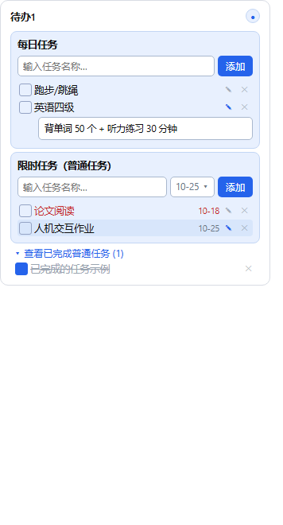
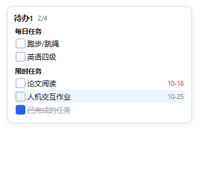

# PaperTodo

桌面悬浮待办清单 —— 胶囊形态迷你入口（类似桌宠）+ 点击展开待办面板。

基于 [snownico0722/PaperTodo](https://github.com/snownico0722/PaperTodo)（v4.0.0-beta1，.NET 10 / WPF / C#）二次开发：完整保留原版「胶囊悬浮 / 拖动 / 置顶 / 文本编辑 / 深浅主题」能力，新增**每日任务与限时任务分区管理、截止日期排序与过期标红、任务备注、启动即展开、系统托盘常驻、卡片化浅蓝主题**等功能。

> 截图说明：程序带有防截屏保护（隐私设计），以下为按实际界面还原的效果图。





---

## 功能特性

### 任务管理

- **每日任务**：只填任务名称、无截止日期；每天 0 点自动重置为未完成，勾选完成的当天从列表隐藏，次日自动恢复并重新出现。
- **限时任务（普通任务）**：带截止日期；未完成任务按截止日期**升序排序**（截止时间越早越靠上），**过期未完成的任务文字标红高亮**。
- **已完成折叠区**：已完成普通任务默认折叠隐藏，面板底部「查看已完成普通任务」开关点击展开 / 收起。
- **任务备注**：限时 / 每日任务均可添加备注——行内展开编辑框、失焦自动保存；有备注的任务图标高亮；备注只在展开面板可见，胶囊小窗口不显示。

### 交互与系统能力

- **胶囊迷你入口**：桌面悬浮胶囊（类桌宠），可拖动、可置顶；鼠标靠近弹出待办小窗口。
- **小窗口预览增强**：分区展示「每日任务 / 限时任务」，显示截止日期并按截止时间排序、过期标红，尺寸随内容动态调整。
- **启动即展开**：应用启动后直接显示展开的待办面板，不进入胶囊隐藏态；会话内的展开 / 收起操作不会污染持久化的用户偏好。
- **系统托盘常驻**：点击最小化收至系统托盘后台常驻；托盘菜单支持「显示窗口 / 退出程序」。
- **数据本地持久化**：全部任务存于本地 JSON 文件（`data.json`），重启程序任务与模板全部保留；每日任务完成状态按日期判断自动重置。

### 外观

- **卡片化 UI**：极简浅蓝 + 白纸黑字，浅色 / 深色双主题色板（主蓝 #2563EB / #5B9BFF）。
- **双添加表单**：限时任务（名称输入框 + 日期选择器 + 添加按钮）、每日任务（名称输入框 + 添加按钮），风格统一、回车可提交。

---

## 技术栈

- **框架**：.NET 10 / WPF / C#
- **界面**：原生 WPF（无第三方 UI 库）
- **存储**：本地 JSON（`data.json`），普通任务 / 每日任务模板 / 当日完成记录分块存储

## 构建与运行

需要 [.NET 10 SDK](https://dotnet.microsoft.com/download/dotnet/10.0)。

```bash
# 1. 拉取子模块（托盘图标依赖）
git submodule update --init

# 2. 编译（Release）
dotnet build -c Release

# 3. 打包为 Windows 单文件可执行程序
dotnet publish -c Release -r win-x64 --self-contained true /p:PublishSingleFile=true -o "输出\PaperTodo-selfcontained"
```

运行 `输出\PaperTodo-selfcontained\PaperTodo.exe` 即可；用户数据保存在 exe 同目录的 `data.json`（已加入 `.gitignore`，不会随仓库提交）。

## 目录结构

```
.
├── src/                  # 主程序源码（WPF）
│   ├── Models.cs         # 数据模型（任务 / 每日任务模板 / 备注 / 截止日期）
│   ├── PaperWindow*.cs   # 展开面板：每日任务 / 限时任务 / 胶囊小窗口
│   ├── AppController.cs  # 状态管理 / 托盘 / 跨天重置
│   └── Theme.cs          # 浅色 / 深色主题色板
├── assets/screenshots/   # 界面截图
├── vendor/wpf-notifyicon # 子模块（托盘图标）
├── PaperTodo.csproj
└── LICENSE.md            # 上游许可声明
```

## 与上游的差异

| 维度 | 原版 PaperTodo | 本仓库（二次开发） |
| --- | --- | --- |
| 任务类型 | 单一待办 | **每日任务 + 限时任务**分区管理 |
| 截止日期 | 无 | 限时任务支持截止日期，**按日期升序排序、过期标红** |
| 已完成任务 | 与未完成混排 | **默认折叠**，底部开关展开 |
| 备注 | 无 | 限时 / 每日任务均支持**任务备注** |
| 启动形态 | 胶囊隐藏 | **启动直接展开待办面板** |
| 最小化 | 普通最小化 | **收至系统托盘常驻** |
| 小窗口预览 | 简单列表 | **分区显示 + 截止日期 + 排序 + 动态尺寸** |
| 主题 | 原配色 | **卡片化浅蓝 + 白纸黑字**双主题 |

## 许可

本项目基于上游 [snownico0722/PaperTodo](https://github.com/snownico0722/PaperTodo) 二次开发，上游采用 **PolyForm Noncommercial 1.0.0**（非商业许可）；本仓库保留上游 `LICENSE.md` 声明，仅供个人学习与使用。
